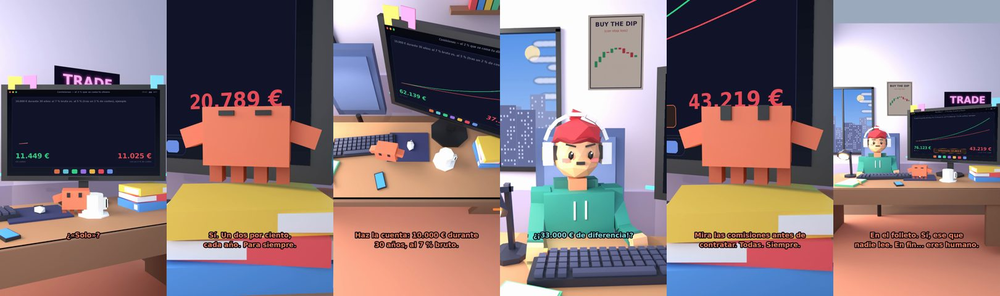

# Claude, mi fondo solo cobra un 2 %



**Archivo de guion:** `guiones/fin_03_las_comisiones.json` · **Ambiente:** `dia_trading` · **Duración:** 42 s (252 frames de animación a 6 fps)

El 2 % «de nada» que se come casi la mitad de tu dinero en 30 años: la cuenta exacta de 10.000 € al 7 % frente al 5 %.

**Gancho (primera frase):** «Claude, mi fondo solo cobra un 2 %.»

## Cómo se genera el vídeo
```bash
python3 -I motor/montar_video.py guiones/fin_03_las_comisiones.json salidas/fin_03_las_comisiones.mp4
```
El guion se creó con `motor/generar_guiones.py` (tiempos automáticos según la longitud de cada frase y pantallas sincronizadas con el diálogo). Biblioteca usada: `biblioteca/dia_trading/`.

## Guion plano a plano

| # | Tiempo | Quién | Texto | Plano | Emoción / pose / estado | Pantalla del monitor |
|---|---|---|---|---|---|---|
| 1 | 0.0–3.1 | Humano | Claude, mi fondo solo / cobra un 2 %. | `humano` | ilusionado | comisiones (24.74 s) |
| 2 | 3.1–4.9 | Claude | ¿«Solo»? | `monitor` | mira_izq |  |
| 3 | 4.9–7.0 | Humano | Es poquísimo. Un dos. | `dos` | bobo |  |
| 4 | 7.0–11.0 | Claude | Sí. Un dos por ciento, / cada año. Para siempre. | `claude_ojos` | feliz |  |
| 5 | 11.0–13.1 | Humano | Es lo mismo que nada. | `humano` | confundido |  |
| 6 | 13.1–17.7 | Claude | Haz la cuenta: 10.000 € durante / 30 años, al 7 % bruto. | `cenital` | mira_der |  |
| 7 | 17.7–19.5 | Humano | ¿Cuánto salen? | `dos` | bobo |  |
| 8 | 19.5–23.5 | Claude | 76.000 €. Con ese 2 % menos, / al 5 %: 43.000 €. | `pantalla_completa` | idle |  |
| 9 | 23.5–26.0 | Humano | ¿¡33.000 € de diferencia!? | `humano` | preocupado |  |
| 10 | 26.0–28.6 | Claude | Por «un 2 %». Qué poquísimo. | `monitor` | feliz |  |
| 11 | 28.6–30.5 | Humano | ¿Y cómo lo evito? | `dos` | preocupado |  |
| 12 | 30.5–35.1 | Claude | Mira las comisiones antes de / contratar. Todas. Siempre. | `claude_ojos` | idle, empuje de cámara |  |
| 13 | 35.1–36.9 | Humano | ¿Dónde las veo? | `humano` | confundido |  |
| 14 | 36.9–42.0 | Claude | En el folleto. Sí, ese que / nadie lee. En fin... eres humano. | `general` | feliz |  |

## Datos reales que aparecen o se mencionan

- Cuenta del ejemplo: 10.000 € durante 30 años; al 7 % anual constante = 76.123 €; al 5 % (tras un 2 % de costes) = 43.219 €; diferencia ≈ 32.900 €. Ilustración matemática: la rentabilidad real varía y los costes reales dependen del producto (mira siempre sus comisiones).
- Los fondos y ETF tienen comisiones de gestión/depósito y costes de compraventa (CNMV).
  - Fuente: [CNMV — Guía «Los fondos cotizados (ETF)»](https://www.cnmv.es/DocPortal/Publicaciones/Guias/Los_fondos_cotizados_ETF.pdf)
  - Fuente: [CNMV — Ficha «Fondos cotizados (ETF)»](https://www.cnmv.es/DocPortal/Publicaciones/Fichas/FondosCotizados(ETF).pdf)

## Notas de producción

- **Humor:** Claude es sarcástico y pícaro («como el que le salva el culo»); el humano es ingenuo y algo tonto (expresiones `bobo`, `ilusionado`, `confundido`).
- **Voces:** son «blips» sintéticos (no hay voz real). Para voz real: ElevenLabs o grabarla y sustituir el audio.
- **Cifras y leyes:** los datos reales están citados arriba; las cuentas de ejemplo (márgenes, 214 tiendas, etc.) son ilustrativas. No es asesoramiento financiero ni legal.
