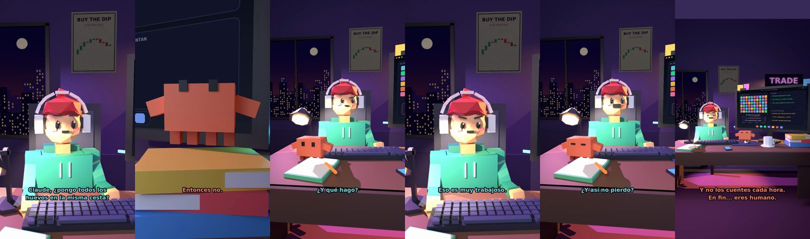

# Claude, ¿pongo todos los huevos en la misma cesta?



**Archivo de guion:** `guiones/fin_04_no_todos_los_huevos.json` · **Ambiente:** `noche_trading` · **Duración:** 40 s (240 frames de animación a 6 fps)

La diversificación explicada con huevos y cestas: repartir el riesgo entre muchas inversiones, sin prometer que elimine las pérdidas.

**Gancho (primera frase):** «Claude, ¿pongo todos los huevos en la misma cesta?»

## Cómo se genera el vídeo
```bash
python3 -I motor/montar_video.py guiones/fin_04_no_todos_los_huevos.json salidas/fin_04_no_todos_los_huevos.mp4
```
El guion se creó con `motor/generar_guiones.py` (tiempos automáticos según la longitud de cada frase y pantallas sincronizadas con el diálogo). Biblioteca usada: `biblioteca/noche_trading/`.

## Guion plano a plano

| # | Tiempo | Quién | Texto | Plano | Emoción / pose / estado | Pantalla del monitor |
|---|---|---|---|---|---|---|
| 1 | 0.0–4.0 | Humano | Claude, ¿pongo todos los / huevos en la misma cesta? | `humano` | ilusionado | etf (24.91 s) |
| 2 | 4.0–6.7 | Claude | Depende. ¿Cuántos huevos tienes? | `monitor` | mira_izq |  |
| 3 | 6.7–8.4 | Humano | Todos mis ahorros. | `dos` | bobo |  |
| 4 | 8.4–10.1 | Claude | Entonces no. | `claude_ojos` | idle |  |
| 5 | 10.1–12.2 | Humano | Pero la cesta es buena. | `humano` | ilusionado |  |
| 6 | 12.2–16.2 | Claude | Todas las cestas son buenas / hasta que se rompe una. | `cenital` | mira_der |  |
| 7 | 16.2–17.9 | Humano | ¿Y qué hago? | `dos` | confundido |  |
| 8 | 17.9–22.4 | Claude | Repartir. Muchas empresas, / muchos sectores, muchos países. | `pantalla_completa` | idle |  |
| 9 | 22.4–24.4 | Humano | Eso es muy trabajoso. | `humano` | preocupado |  |
| 10 | 24.4–28.5 | Claude | Un ETF lo hace de golpe: / una cesta con muchas cestas. | `claude_ojos` | feliz, empuje de cámara |  |
| 11 | 28.5–30.2 | Humano | ¿Y así no pierdo? | `dos` | ilusionado |  |
| 12 | 30.2–33.7 | Claude | Sí puedes perder. Pero / no por un solo huevo. | `monitor` | feliz |  |
| 13 | 33.7–36.0 | Humano | Voy a repartir los huevos. | `humano` | feliz |  |
| 14 | 36.0–40.0 | Claude | Y no los cuentes cada hora. / En fin... eres humano. | `general` | feliz |  |

## Datos reales que aparecen o se mencionan

- Concepto educativo: diversificar reparte el riesgo entre varios activos; no lo elimina. Un ETF indexado es una forma de tener muchas empresas en un solo producto (CNMV).
  - Fuente: [CNMV — Guía «Los fondos cotizados (ETF)»](https://www.cnmv.es/DocPortal/Publicaciones/Guias/Los_fondos_cotizados_ETF.pdf)
  - Fuente: [CNMV — Ficha «Fondos cotizados (ETF)»](https://www.cnmv.es/DocPortal/Publicaciones/Fichas/FondosCotizados(ETF).pdf)

## Notas de producción

- **Humor:** Claude es sarcástico y pícaro («como el que le salva el culo»); el humano es ingenuo y algo tonto (expresiones `bobo`, `ilusionado`, `confundido`).
- **Voces:** son «blips» sintéticos (no hay voz real). Para voz real: ElevenLabs o grabarla y sustituir el audio.
- **Cifras y leyes:** los datos reales están citados arriba; las cuentas de ejemplo (márgenes, 214 tiendas, etc.) son ilustrativas. No es asesoramiento financiero ni legal.
