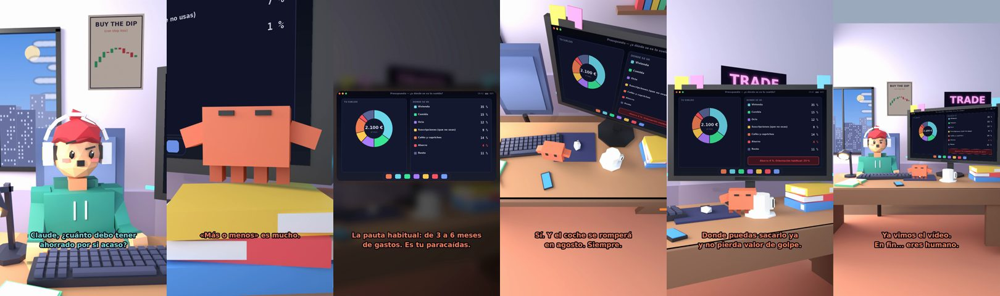

# Claude, ¿cuánto debo tener ahorrado por si acaso?



**Archivo de guion:** `guiones/fin_05_fondo_de_emergencia.json` · **Ambiente:** `dia_trading` · **Duración:** 38 s (228 frames de animación a 6 fps)

El fondo de emergencia: una pauta habitual de unos 3 a 6 meses de gastos antes de asumir riesgos, con el humor de «el coche siempre se rompe en agosto».

**Gancho (primera frase):** «Claude, ¿cuánto debo tener ahorrado por si acaso?»

## Cómo se genera el vídeo
```bash
python3 -I motor/montar_video.py guiones/fin_05_fondo_de_emergencia.json salidas/fin_05_fondo_de_emergencia.mp4
```
El guion se creó con `motor/generar_guiones.py` (tiempos automáticos según la longitud de cada frase y pantallas sincronizadas con el diálogo). Biblioteca usada: `biblioteca/dia_trading/`.

## Guion plano a plano

| # | Tiempo | Quién | Texto | Plano | Emoción / pose / estado | Pantalla del monitor |
|---|---|---|---|---|---|---|
| 1 | 0.0–4.3 | Humano | Claude, ¿cuánto debo tener / ahorrado por si acaso? | `humano` | confundido | presupuesto (21.29 s) |
| 2 | 4.3–6.5 | Claude | ¿Cuánto gastas al mes? | `monitor` | mira_izq |  |
| 3 | 6.5–9.1 | Humano | Unos 1.800 €. Más o menos. | `dos` | bobo |  |
| 4 | 9.1–11.4 | Claude | «Más o menos» es mucho. | `claude_ojos` | feliz |  |
| 5 | 11.4–13.8 | Humano | ¿Y cuántos meses guardo? | `humano` | confundido |  |
| 6 | 13.8–19.2 | Claude | La pauta habitual: de 3 a 6 meses / de gastos. Es tu paracaídas. | `pantalla_completa` | idle |  |
| 7 | 19.2–21.3 | Humano | ¿5.400 € como mínimo? | `dos` | preocupado |  |
| 8 | 21.3–25.3 | Claude | Sí. Y el coche se romperá / en agosto. Siempre. | `cenital` | mira_der |  |
| 9 | 25.3–27.1 | Humano | ¿Dónde lo guardo? | `humano` | confundido |  |
| 10 | 27.1–31.6 | Claude | Donde puedas sacarlo ya / y no pierda valor de golpe. | `monitor` | feliz |  |
| 11 | 31.6–34.3 | Humano | ¿Y si lo invierto en cripto? | `dos` | bobo |  |
| 12 | 34.3–38.0 | Claude | Ya vimos el vídeo. / En fin... eres humano. | `general` | feliz |  |

## Datos reales que aparecen o se mencionan

- Pauta habitual (no una norma): tener un fondo de emergencia de unos 3 a 6 meses de gastos antes de invertir en activos de riesgo. Cada situación es distinta; no es asesoramiento financiero.

## Notas de producción

- **Humor:** Claude es sarcástico y pícaro («como el que le salva el culo»); el humano es ingenuo y algo tonto (expresiones `bobo`, `ilusionado`, `confundido`).
- **Voces:** son «blips» sintéticos (no hay voz real). Para voz real: ElevenLabs o grabarla y sustituir el audio.
- **Cifras y leyes:** los datos reales están citados arriba; las cuentas de ejemplo (márgenes, 214 tiendas, etc.) son ilustrativas. No es asesoramiento financiero ni legal.
