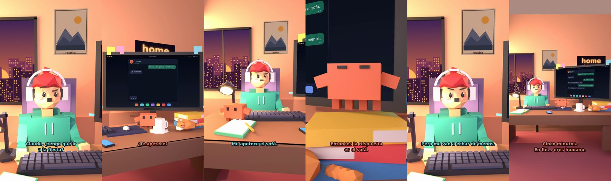

# Claude, ¿tengo que ir a la fiesta?



**Archivo de guion:** `guiones/micro_09_ya_voy.json` · **Ambiente:** `atardecer_casa` · **Duración:** 20 s (120 frames de animación a 6 fps)

Micro-vídeo de humor de ~20 s, sin datos reales.

**Gancho (primera frase):** «Claude, ¿tengo que ir a la fiesta?»

## Cómo se genera el vídeo
```bash
python3 -I motor/montar_video.py guiones/micro_09_ya_voy.json salidas/micro_09_ya_voy.mp4
```
El guion se creó con `motor/generar_guiones.py` (tiempos automáticos según la longitud de cada frase y pantallas sincronizadas con el diálogo). Biblioteca usada: `biblioteca/atardecer_casa/`.

## Guion plano a plano

| # | Tiempo | Quién | Texto | Plano | Emoción / pose / estado | Pantalla del monitor |
|---|---|---|---|---|---|---|
| 1 | 0.0–3.9 | Humano | Claude, ¿tengo que ir / a la fiesta? | `humano` | confundido | mensajes (20.0 s) |
| 2 | 3.9–6.2 | Claude | ¿Te apetece? | `monitor` | mira_izq |  |
| 3 | 6.2–8.6 | Humano | Me apetece el sofá. | `dos` | bobo |  |
| 4 | 8.6–12.4 | Claude | Entonces la respuesta / es el sofá. | `claude_ojos` | feliz |  |
| 5 | 12.4–15.8 | Humano | Pero me van a echar de menos. | `humano` | preocupado |  |
| 6 | 15.8–20.0 | Claude | Cinco minutos. / En fin... eres humano. | `general` | feliz |  |

## Datos reales que aparecen o se mencionan

- Vídeo de humor, sin datos reales.

## Notas de producción

- **Humor:** Claude es sarcástico y pícaro («como el que le salva el culo»); el humano es ingenuo y algo tonto (expresiones `bobo`, `ilusionado`, `confundido`).
- **Voces:** son «blips» sintéticos (no hay voz real). Para voz real: ElevenLabs o grabarla y sustituir el audio.
- **Cifras y leyes:** los datos reales están citados arriba; las cuentas de ejemplo (márgenes, 214 tiendas, etc.) son ilustrativas. No es asesoramiento financiero ni legal.
