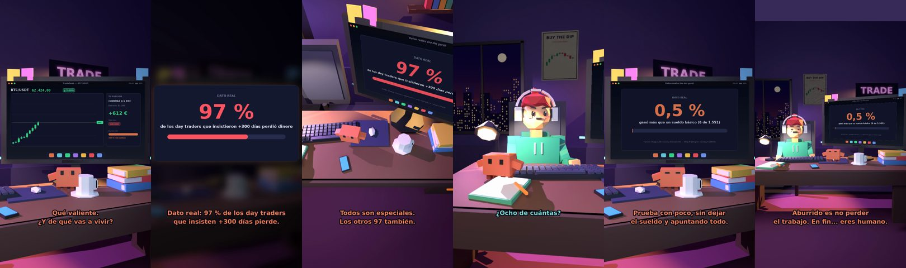

# Voy a dejar mi trabajo para ser day trader



**Archivo de guion:** `guiones/trading_06_dejar_el_trabajo.json` · **Ambiente:** `noche_trading` · **Duración:** 45 s (270 frames de animación a 6 fps)

El tonto quiere dejar su empleo para hacer day trading. Claude le enseña con datos reales qué pasa con quienes lo intentan de forma persistente y qué hacer en su lugar (probar a pequeña escala sin dejar el sueldo).

**Gancho (primera frase):** «Claude, voy a dejar mi trabajo para ser day trader.»

## Cómo se genera el vídeo
```bash
python3 -I motor/montar_video.py guiones/trading_06_dejar_el_trabajo.json salidas/trading_06_dejar_el_trabajo.mp4
```
El guion se creó con `motor/generar_guiones.py` (tiempos automáticos según la longitud de cada frase y pantallas sincronizadas con el diálogo). Biblioteca usada: `biblioteca/noche_trading/`.

## Guion plano a plano

| # | Tiempo | Quién | Texto | Plano | Emoción / pose / estado | Pantalla del monitor |
|---|---|---|---|---|---|---|
| 1 | 0.0–3.6 | Humano | Claude, voy a dejar mi trabajo / para ser day trader. | `humano` | ilusionado | trading (9.21 s) |
| 2 | 3.6–6.2 | Claude | Qué valiente. / ¿Y de qué vas a vivir? | `monitor` | mira_izq |  |
| 3 | 6.2–7.7 | Humano | De las ganancias. | `dos` | bobo |  |
| 4 | 7.7–9.2 | Claude | Ya. ¿Y cuáles son? | `claude_ojos` | feliz |  |
| 5 | 9.2–10.9 | Humano | Las que voy a tener. | `humano` | ilusionado | verdad (6.13 s) |
| 6 | 10.9–15.3 | Claude | Dato real: 97 % de los day traders / que insisten +300 días pierde. | `pantalla_completa` | idle |  |
| 7 | 15.3–17.1 | Humano | Pero yo soy especial. | `dos` | bobo |  |
| 8 | 17.1–20.1 | Claude | Todos son especiales. / Los otros 97 también. | `cenital` | mira_der |  |
| 9 | 20.1–21.6 | Humano | ¿Y el 3 %? | `humano` | confundido | verdad (5.24 s) |
| 10 | 21.6–25.4 | Claude | El 0,5 % ganó más que un / sueldo básico. Ocho personas. | `pantalla_completa` | idle |  |
| 11 | 25.4–26.9 | Humano | ¿Ocho de cuántas? | `dos` | preocupado |  |
| 12 | 26.9–29.2 | Claude | Mil quinientas cincuenta y una. | `claude_ojos` | idle, empuje de cámara |  |
| 13 | 29.2–30.9 | Humano | Vale... ¿y qué hago? | `humano` | preocupado |  |
| 14 | 30.9–34.6 | Claude | Prueba con poco, sin dejar / el sueldo y apuntando todo. | `monitor` | feliz |  |
| 15 | 34.6–36.1 | Humano | ¿Y si me va bien? | `dos` | ilusionado |  |
| 16 | 36.1–39.6 | Claude | Entonces lo celebraremos / con un sueldo de reserva. | `cenital` | mira_der |  |
| 17 | 39.6–41.1 | Humano | Qué aburrido. | `humano` | feliz |  |
| 18 | 41.1–45.0 | Claude | Aburrido es no perder / el trabajo. En fin... eres humano. | `general` | feliz |  |

## Datos reales que aparecen o se mencionan

- 97 % de los day traders brasileños que persistieron más de 300 días perdió dinero; solo el 0,5 % (8 de 1.551) ganó más que un sueldo básico de banca (estudio con datos de la CVM brasileña, 2013-2015).
  - Fuente: [Chague, De-Losso y Giovannetti — «Day Trading for a Living?» (SSRN)](https://papers.ssrn.com/sol3/papers.cfm?abstract_id=3423101)
  - Fuente: [Resumen del estudio (Quantpedia)](https://quantpedia.com/retail-day-trading-is-an-uphill-battle/)
- Recomendación de sentido común (no asesoramiento financiero): no abandones una fuente de ingresos estable para operar y no arriesgues dinero que no puedas perder.

## Notas de producción

- **Humor:** Claude es sarcástico y pícaro («como el que le salva el culo»); el humano es ingenuo y algo tonto (expresiones `bobo`, `ilusionado`, `confundido`).
- **Voces:** son «blips» sintéticos (no hay voz real). Para voz real: ElevenLabs o grabarla y sustituir el audio.
- **Cifras y leyes:** los datos reales están citados arriba; las cuentas de ejemplo (márgenes, 214 tiendas, etc.) son ilustrativas. No es asesoramiento financiero ni legal.
