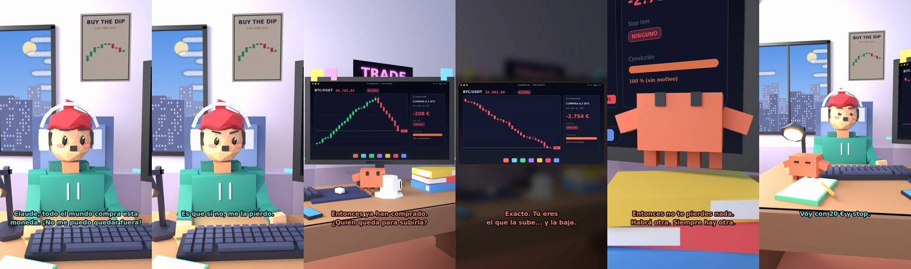

# Todo el mundo compra esta moneda. ¡No me puedo quedar fuera!



**Archivo de guion:** `guiones/trading_07_miedo_a_quedarse_fuera.json` · **Ambiente:** `dia_trading` · **Duración:** 44 s (264 frames de animación a 6 fps)

El FOMO: todos compran, el precio sube y el tonto quiere entrar al máximo. Claude le enseña que quien entra por miedo a quedarse fuera suele comprar caro, y que el stop loss existe por algo.

**Gancho (primera frase):** «Claude, todo el mundo compra esta moneda. ¡No me puedo quedar fuera!»

## Cómo se genera el vídeo
```bash
python3 -I motor/montar_video.py guiones/trading_07_miedo_a_quedarse_fuera.json salidas/trading_07_miedo_a_quedarse_fuera.mp4
```
El guion se creó con `motor/generar_guiones.py` (tiempos automáticos según la longitud de cada frase y pantallas sincronizadas con el diálogo). Biblioteca usada: `biblioteca/dia_trading/`.

## Guion plano a plano

| # | Tiempo | Quién | Texto | Plano | Emoción / pose / estado | Pantalla del monitor |
|---|---|---|---|---|---|---|
| 1 | 0.0–5.2 | Humano | Claude, todo el mundo compra esta / moneda. ¡No me puedo quedar fuera! | `humano` | ilusionado | telegram (10.89 s) |
| 2 | 5.2–6.9 | Claude | ¿Cuánto ha subido? | `monitor` | mira_izq |  |
| 3 | 6.9–8.8 | Humano | Un 400 % esta semana. | `dos` | bobo |  |
| 4 | 8.8–10.9 | Claude | Y quieres entrar ahora. | `claude_ojos` | feliz |  |
| 5 | 10.9–13.2 | Humano | Es que si no, me la pierdo. | `humano` | preocupado | trading (6.71 s) |
| 6 | 13.2–15.6 | Claude | ¿Quién te dijo que subiría? | `cenital` | mira_der |  |
| 7 | 15.6–18.1 | Humano | Mi grupo. Todos la compraron. | `dos` | ilusionado |  |
| 8 | 18.1–22.1 | Claude | Entonces ya han comprado. / ¿Quién queda para subirla? | `monitor` | mira_arriba |  |
| 9 | 22.1–23.8 | Humano | ...Yo. | `humano` | confundido |  |
| 10 | 23.8–27.3 | Claude | Exacto. Tú eres / el que la sube... y la baja. | `pantalla_completa` | idle | trading (1.0 s) |
| 11 | 27.3–28.9 | Humano | ¿Y si espero? | `dos` | bobo |  |
| 12 | 28.9–33.4 | Claude | Entonces no te pierdes nada. / Habrá otra. Siempre hay otra. | `claude_ojos` | idle, empuje de cámara |  |
| 13 | 33.4–35.3 | Humano | ¿Y si entro con poco? | `humano` | ilusionado |  |
| 14 | 35.3–39.3 | Claude | Poco y con stop loss. / Es el trato de los valientes. | `monitor` | feliz |  |
| 15 | 39.3–41.1 | Humano | Voy con 20 € y stop. | `dos` | feliz |  |
| 16 | 41.1–44.0 | Claude | Qué madurez. / En fin... eres humano. | `general` | feliz |  |

## Datos reales que aparecen o se mencionan

- FOMO (miedo a quedarse fuera): comprar después de una gran subida por presión social suele implicar entrar a precios altos. Explicación general, sin garantías ni asesoramiento.
- Referencia citada: 74–89 % de cuentas minoristas de CFD pierde dinero (ESMA, 2018).
  - Fuente: [ESMA (2018): prohíbe las opciones binarias y restringe los CFD a minoristas](https://www.esma.europa.eu/node/84933)
  - Fuente: [ESMA: renovación de las restricciones a los CFD](https://www.esma.europa.eu/press-news/esma-news/esma-renew-restriction-cfds-further-three-months)

## Notas de producción

- **Humor:** Claude es sarcástico y pícaro («como el que le salva el culo»); el humano es ingenuo y algo tonto (expresiones `bobo`, `ilusionado`, `confundido`).
- **Voces:** son «blips» sintéticos (no hay voz real). Para voz real: ElevenLabs o grabarla y sustituir el audio.
- **Cifras y leyes:** los datos reales están citados arriba; las cuentas de ejemplo (márgenes, 214 tiendas, etc.) son ilustrativas. No es asesoramiento financiero ni legal.
