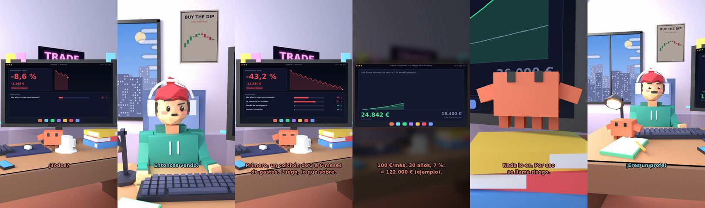

# Claude, ¿meto todos mis ahorros en cripto?



**Archivo de guion:** `guiones/trading_08_ahorros_en_cripto.json` · **Ambiente:** `dia_trading` · **Duración:** 44 s (264 frames de animación a 6 fps)

El tonto quiere meter todo su colchón en una moneda. Claude le explica el fondo de emergencia, la diversificación y el riesgo, con el dato de interés compuesto como alternativa aburrida.

**Gancho (primera frase):** «Claude, ¿meto todos mis ahorros en cripto?»

## Cómo se genera el vídeo
```bash
python3 -I motor/montar_video.py guiones/trading_08_ahorros_en_cripto.json salidas/trading_08_ahorros_en_cripto.mp4
```
El guion se creó con `motor/generar_guiones.py` (tiempos automáticos según la longitud de cada frase y pantallas sincronizadas con el diálogo). Biblioteca usada: `biblioteca/dia_trading/`.

## Guion plano a plano

| # | Tiempo | Quién | Texto | Plano | Emoción / pose / estado | Pantalla del monitor |
|---|---|---|---|---|---|---|
| 1 | 0.0–3.5 | Humano | Claude, ¿meto todos mis / ahorros en cripto? | `humano` | ilusionado | cartera (17.92 s) |
| 2 | 3.5–5.3 | Claude | ¿Todos? | `monitor` | mira_izq |  |
| 3 | 5.3–7.4 | Humano | Todos. Para ganar más. | `dos` | bobo |  |
| 4 | 7.4–10.8 | Claude | ¿Y si necesitas dinero / el mes que viene? | `claude_ojos` | idle |  |
| 5 | 10.8–12.6 | Humano | Entonces vendo. | `humano` | confundido |  |
| 6 | 12.6–16.1 | Claude | Si ha bajado, vendes / con pérdida. Clásico. | `cenital` | mira_der |  |
| 7 | 16.1–17.9 | Humano | ¿Y qué hago? | `dos` | preocupado |  |
| 8 | 17.9–23.2 | Claude | Primero, un colchón de 3 a 6 meses / de gastos. Luego, lo que sobre. | `monitor` | feliz |  |
| 9 | 23.2–25.0 | Humano | Eso es muy lento. | `humano` | preocupado | interes (6.31 s) |
| 10 | 25.0–28.9 | Claude | 100 €/mes, 30 años, 7 %: / ≈ 122.000 € (ejemplo). | `pantalla_completa` | idle |  |
| 11 | 28.9–30.7 | Humano | ¿Eso es seguro? | `dos` | confundido |  |
| 12 | 30.7–33.8 | Claude | Nada lo es. Por eso / se llama riesgo. | `claude_ojos` | idle, empuje de cámara |  |
| 13 | 33.8–35.6 | Humano | Vale. Solo un 5 %. | `humano` | ilusionado |  |
| 14 | 35.6–38.9 | Claude | Y con ese 5 %, con stop. / Qué evolución. | `monitor` | mira_arriba |  |
| 15 | 38.9–40.7 | Humano | ¡Eres un profe! | `dos` | feliz |  |
| 16 | 40.7–44.0 | Claude | Y tú, un alumno. / En fin... eres humano. | `general` | feliz |  |

## Datos reales que aparecen o se mencionan

- Orientación habitual: tener un fondo de emergencia (de unos 3 a 6 meses de gastos) antes de asumir riesgos, y no invertir dinero que puedas necesitar a corto plazo. Es una pauta general, no asesoramiento.
- Ejemplo de interés compuesto: 100 €/mes durante 30 años al 7 % anual constante ≈ 122.000 € (aportado: 36.000 €). Ilustración matemática: la rentabilidad real varía y no está garantizada.

## Notas de producción

- **Humor:** Claude es sarcástico y pícaro («como el que le salva el culo»); el humano es ingenuo y algo tonto (expresiones `bobo`, `ilusionado`, `confundido`).
- **Voces:** son «blips» sintéticos (no hay voz real). Para voz real: ElevenLabs o grabarla y sustituir el audio.
- **Cifras y leyes:** los datos reales están citados arriba; las cuentas de ejemplo (márgenes, 214 tiendas, etc.) son ilustrativas. No es asesoramiento financiero ni legal.
