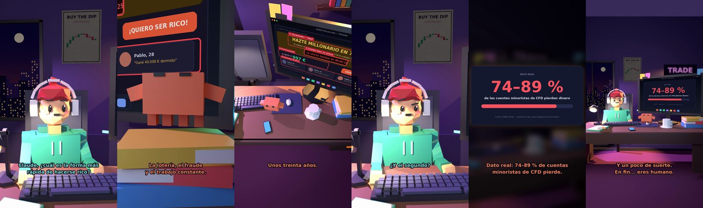

# Claude, ¿cuál es la forma más rápida de hacerse rico?



**Archivo de guion:** `guiones/trading_09_hacerse_rico_rapido.json` · **Ambiente:** `noche_trading` · **Duración:** 40 s (240 frames de animación a 6 fps)

La pregunta clásica. Claude repasa las «vías rápidas» y acaba en la aburrida: tiempo, ahorro y paciencia.

**Gancho (primera frase):** «Claude, ¿cuál es la forma más rápida de hacerse rico?»

## Cómo se genera el vídeo
```bash
python3 -I motor/montar_video.py guiones/trading_09_hacerse_rico_rapido.json salidas/trading_09_hacerse_rico_rapido.mp4
```
El guion se creó con `motor/generar_guiones.py` (tiempos automáticos según la longitud de cada frase y pantallas sincronizadas con el diálogo). Biblioteca usada: `biblioteca/noche_trading/`.

## Guion plano a plano

| # | Tiempo | Quién | Texto | Plano | Emoción / pose / estado | Pantalla del monitor |
|---|---|---|---|---|---|---|
| 1 | 0.0–4.7 | Humano | Claude, ¿cuál es la forma más / rápida de hacerse rico? | `humano` | ilusionado | curso (13.07 s) |
| 2 | 4.7–6.5 | Claude | Hay tres. | `monitor` | mira_izq |  |
| 3 | 6.5–8.4 | Humano | ¡Dime! | `dos` | ilusionado |  |
| 4 | 8.4–12.4 | Claude | La lotería, el fraude / y el trabajo constante. | `claude_ojos` | feliz |  |
| 5 | 12.4–14.9 | Humano | ¿El tercero cuánto tarda? | `humano` | bobo |  |
| 6 | 14.9–16.9 | Claude | Unos treinta años. | `cenital` | mira_der |  |
| 7 | 16.9–18.7 | Humano | ¿Y el primero? | `dos` | ilusionado |  |
| 8 | 18.7–22.6 | Claude | Casi nunca toca. Pero / la ilusión es gratis. | `monitor` | feliz |  |
| 9 | 22.6–24.4 | Humano | ¿Y el segundo? | `humano` | confundido |  |
| 10 | 24.4–27.0 | Claude | Es ilegal. No hay segundo. | `claude_ojos` | idle, empuje de cámara |  |
| 11 | 27.0–28.9 | Humano | ¿Y el trading? | `dos` | bobo | verdad (1.86 s) |
| 12 | 28.9–33.7 | Claude | Dato real: 74–89 % de cuentas / minoristas de CFD pierde. | `pantalla_completa` | idle |  |
| 13 | 33.7–36.1 | Humano | Entonces... ¿constancia? | `humano` | confundido |  |
| 14 | 36.1–40.0 | Claude | Y un poco de suerte. / En fin... eres humano. | `general` | feliz |  |

## Datos reales que aparecen o se mencionan

- Ejemplo de interés compuesto: 100 €/mes durante 30 años al 7 % anual constante ≈ 122.000 €. Ilustración matemática, no una promesa.
- Referencia: 74–89 % de cuentas minoristas de CFD pierde dinero (ESMA, 2018).
  - Fuente: [ESMA (2018): prohíbe las opciones binarias y restringe los CFD a minoristas](https://www.esma.europa.eu/node/84933)
  - Fuente: [ESMA: renovación de las restricciones a los CFD](https://www.esma.europa.eu/press-news/esma-news/esma-renew-restriction-cfds-further-three-months)

## Notas de producción

- **Humor:** Claude es sarcástico y pícaro («como el que le salva el culo»); el humano es ingenuo y algo tonto (expresiones `bobo`, `ilusionado`, `confundido`).
- **Voces:** son «blips» sintéticos (no hay voz real). Para voz real: ElevenLabs o grabarla y sustituir el audio.
- **Cifras y leyes:** los datos reales están citados arriba; las cuentas de ejemplo (márgenes, 214 tiendas, etc.) son ilustrativas. No es asesoramiento financiero ni legal.
