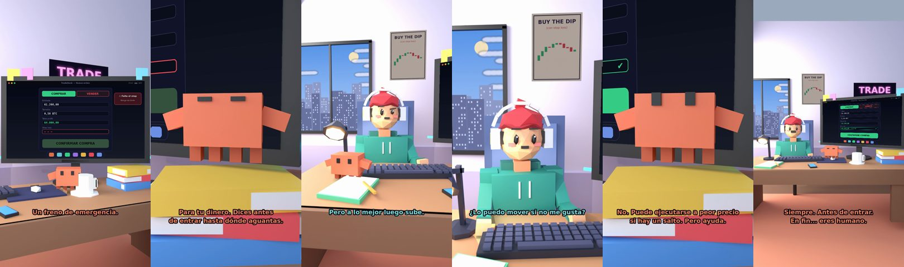

# Claude, ¿qué es un stop loss?



**Archivo de guion:** `guiones/trading_10_que_es_un_stop_loss.json` · **Ambiente:** `dia_trading` · **Duración:** 40 s (240 frames de animación a 6 fps)

El stop loss explicado como un freno de emergencia: se define antes de entrar, limita la pérdida y no se mueve «solo un poquito».

**Gancho (primera frase):** «Claude, ¿qué es un stop loss?»

## Cómo se genera el vídeo
```bash
python3 -I motor/montar_video.py guiones/trading_10_que_es_un_stop_loss.json salidas/trading_10_que_es_un_stop_loss.mp4
```
El guion se creó con `motor/generar_guiones.py` (tiempos automáticos según la longitud de cada frase y pantallas sincronizadas con el diálogo). Biblioteca usada: `biblioteca/dia_trading/`.

## Guion plano a plano

| # | Tiempo | Quién | Texto | Plano | Emoción / pose / estado | Pantalla del monitor |
|---|---|---|---|---|---|---|
| 1 | 0.0–2.4 | Humano | Claude, ¿qué es un stop loss? | `humano` | confundido | orden (23.89 s) |
| 2 | 2.4–4.5 | Claude | Un freno de emergencia. | `monitor` | mira_izq |  |
| 3 | 4.5–6.1 | Humano | ¿Para el coche? | `dos` | bobo |  |
| 4 | 6.1–10.5 | Claude | Para tu dinero. Dices antes / de entrar hasta dónde aguantas. | `claude_ojos` | feliz |  |
| 5 | 10.5–12.1 | Humano | ¿Y si baja más? | `humano` | preocupado |  |
| 6 | 12.1–15.4 | Claude | Se vende solo. Tú no sufres / ni lo discutes. | `cenital` | mira_der |  |
| 7 | 15.4–17.8 | Humano | Pero a lo mejor luego sube. | `dos` | bobo |  |
| 8 | 17.8–21.5 | Claude | A lo mejor. Y a lo mejor no. / Por eso es un freno. | `pantalla_completa` | idle |  |
| 9 | 21.5–24.1 | Humano | ¿Lo puedo mover si no me gusta? | `humano` | ilusionado |  |
| 10 | 24.1–27.7 | Claude | «Solo un poquito». / Así empiezan las desgracias. | `monitor` | feliz |  |
| 11 | 27.7–29.3 | Humano | ¿Es perfecto? | `dos` | confundido |  |
| 12 | 29.3–34.0 | Claude | No. Puede ejecutarse a peor precio / si hay un salto. Pero ayuda. | `claude_ojos` | idle, empuje de cámara |  |
| 13 | 34.0–36.3 | Humano | Entonces siempre pongo uno. | `humano` | ilusionado |  |
| 14 | 36.3–40.0 | Claude | Siempre. Antes de entrar. / En fin... eres humano. | `general` | feliz |  |

## Datos reales que aparecen o se mencionan

- Concepto educativo: un stop loss es una orden que cierra la posición si el precio llega a un nivel; limita la pérdida pero no la elimina (puede ejecutarse a un precio peor en saltos de precio). No es asesoramiento financiero.

## Notas de producción

- **Humor:** Claude es sarcástico y pícaro («como el que le salva el culo»); el humano es ingenuo y algo tonto (expresiones `bobo`, `ilusionado`, `confundido`).
- **Voces:** son «blips» sintéticos (no hay voz real). Para voz real: ElevenLabs o grabarla y sustituir el audio.
- **Cifras y leyes:** los datos reales están citados arriba; las cuentas de ejemplo (márgenes, 214 tiendas, etc.) son ilustrativas. No es asesoramiento financiero ni legal.
