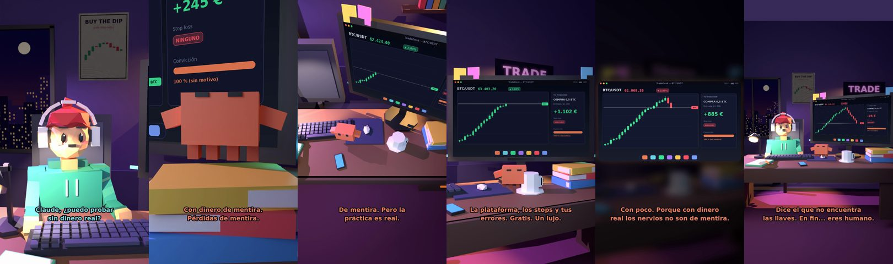

# Claude, ¿puedo probar sin dinero real?



**Archivo de guion:** `guiones/trading_11_cuenta_demo.json` · **Ambiente:** `noche_trading` · **Duración:** 40 s (240 frames de animación a 6 fps)

La cuenta demo como gimnasio del trading: practicar sin arriesgar, aunque con la advertencia de que los nervios con dinero real son otros.

**Gancho (primera frase):** «Claude, ¿puedo probar sin dinero real?»

## Cómo se genera el vídeo
```bash
python3 -I motor/montar_video.py guiones/trading_11_cuenta_demo.json salidas/trading_11_cuenta_demo.mp4
```
El guion se creó con `motor/generar_guiones.py` (tiempos automáticos según la longitud de cada frase y pantallas sincronizadas con el diálogo). Biblioteca usada: `biblioteca/noche_trading/`.

## Guion plano a plano

| # | Tiempo | Quién | Texto | Plano | Emoción / pose / estado | Pantalla del monitor |
|---|---|---|---|---|---|---|
| 1 | 0.0–3.4 | Humano | Claude, ¿puedo probar / sin dinero real? | `humano` | ilusionado | trading (40.94 s) |
| 2 | 3.4–5.9 | Claude | Sí. Se llama cuenta demo. | `monitor` | mira_izq |  |
| 3 | 5.9–8.2 | Humano | ¿Con dinero de mentira? | `dos` | bobo |  |
| 4 | 8.2–12.0 | Claude | Con dinero de mentira. / Pérdidas de mentira. | `claude_ojos` | feliz |  |
| 5 | 12.0–14.5 | Humano | ¡Entonces soy millonario! | `humano` | ilusionado |  |
| 6 | 14.5–17.9 | Claude | De mentira. Pero la / práctica es real. | `cenital` | mira_der |  |
| 7 | 17.9–19.7 | Humano | ¿Y qué aprendo? | `dos` | confundido |  |
| 8 | 19.7–24.6 | Claude | La plataforma, los stops y tus / errores. Gratis. Un lujo. | `monitor` | feliz |  |
| 9 | 24.6–27.3 | Humano | ¿Y luego paso al dinero real? | `humano` | ilusionado |  |
| 10 | 27.3–32.8 | Claude | Con poco. Porque con dinero / real los nervios no son de mentira. | `pantalla_completa` | idle |  |
| 11 | 32.8–34.9 | Humano | Yo soy muy tranquilo. | `dos` | bobo |  |
| 12 | 34.9–40.0 | Claude | Dice el que no encuentra / las llaves. En fin... eres humano. | `general` | feliz |  |

## Datos reales que aparecen o se mencionan

- Concepto educativo: una cuenta demo simula operaciones sin dinero real; sirve para aprender la plataforma y probar ideas, pero no reproduce la presión emocional del dinero real. No es asesoramiento financiero.

## Notas de producción

- **Humor:** Claude es sarcástico y pícaro («como el que le salva el culo»); el humano es ingenuo y algo tonto (expresiones `bobo`, `ilusionado`, `confundido`).
- **Voces:** son «blips» sintéticos (no hay voz real). Para voz real: ElevenLabs o grabarla y sustituir el audio.
- **Cifras y leyes:** los datos reales están citados arriba; las cuentas de ejemplo (márgenes, 214 tiendas, etc.) son ilustrativas. No es asesoramiento financiero ni legal.
