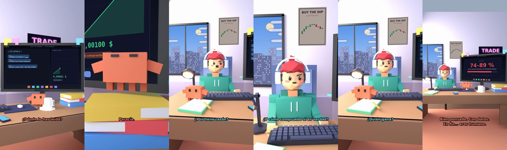

# Claude, he leído que mañana sube todo



**Archivo de guion:** `guiones/trading_12_noticia_falsa.json` · **Ambiente:** `dia_trading` · **Duración:** 40 s (240 frames de animación a 6 fps)

El «he leído en un grupo que mañana sube todo». Claude enseña a desconfiar de rumores, comprobar la fuente y no operar por un titular.

**Gancho (primera frase):** «Claude, he leído que mañana sube todo.»

## Cómo se genera el vídeo
```bash
python3 -I motor/montar_video.py guiones/trading_12_noticia_falsa.json salidas/trading_12_noticia_falsa.mp4
```
El guion se creó con `motor/generar_guiones.py` (tiempos automáticos según la longitud de cada frase y pantallas sincronizadas con el diálogo). Biblioteca usada: `biblioteca/dia_trading/`.

## Guion plano a plano

| # | Tiempo | Quién | Texto | Plano | Emoción / pose / estado | Pantalla del monitor |
|---|---|---|---|---|---|---|
| 1 | 0.0–3.2 | Humano | Claude, he leído que / mañana sube todo. | `humano` | ilusionado | telegram (10.57 s) |
| 2 | 3.2–5.2 | Claude | ¿Dónde lo has leído? | `monitor` | mira_izq |  |
| 3 | 5.2–8.8 | Humano | En un grupo. Lo dijo uno / que parecía listo. | `dos` | bobo |  |
| 4 | 8.8–10.6 | Claude | Parecía. | `claude_ojos` | feliz |  |
| 5 | 10.6–13.1 | Humano | Tiene una foto con corbata. | `humano` | ilusionado |  |
| 6 | 13.1–16.0 | Claude | La corbata no predice el mercado. | `cenital` | mira_der |  |
| 7 | 16.0–17.8 | Humano | ¿Y si tiene razón? | `dos` | confundido |  |
| 8 | 17.8–21.9 | Claude | Si tuviera razón, no lo / diría en un grupo gratis. | `monitor` | feliz |  |
| 9 | 21.9–24.7 | Humano | ¿Y cómo compruebo si es verdad? | `humano` | confundido |  |
| 10 | 24.7–28.8 | Claude | Fuente, fecha y quién gana / con que tú te lo creas. | `claude_ojos` | idle, empuje de cámara |  |
| 11 | 28.8–30.6 | Humano | ¿Quién gana? | `dos` | bobo |  |
| 12 | 30.6–34.0 | Claude | El que ya compró. / Y necesita compradores. | `pantalla_completa` | idle | verdad (3.47 s) |
| 13 | 34.0–36.1 | Humano | Qué mal pensado eres. | `humano` | preocupado |  |
| 14 | 36.1–40.0 | Claude | Bien pensado. Con datos. / En fin... eres humano. | `general` | feliz |  |

## Datos reales que aparecen o se mencionan

- Consejo general: contrastar la fuente y no operar por rumores de grupos o titulares; el 74–89 % de cuentas minoristas de CFD pierde dinero (ESMA, 2018).
  - Fuente: [ESMA (2018): prohíbe las opciones binarias y restringe los CFD a minoristas](https://www.esma.europa.eu/node/84933)
  - Fuente: [ESMA: renovación de las restricciones a los CFD](https://www.esma.europa.eu/press-news/esma-news/esma-renew-restriction-cfds-further-three-months)

## Notas de producción

- **Humor:** Claude es sarcástico y pícaro («como el que le salva el culo»); el humano es ingenuo y algo tonto (expresiones `bobo`, `ilusionado`, `confundido`).
- **Voces:** son «blips» sintéticos (no hay voz real). Para voz real: ElevenLabs o grabarla y sustituir el audio.
- **Cifras y leyes:** los datos reales están citados arriba; las cuentas de ejemplo (márgenes, 214 tiendas, etc.) son ilustrativas. No es asesoramiento financiero ni legal.
