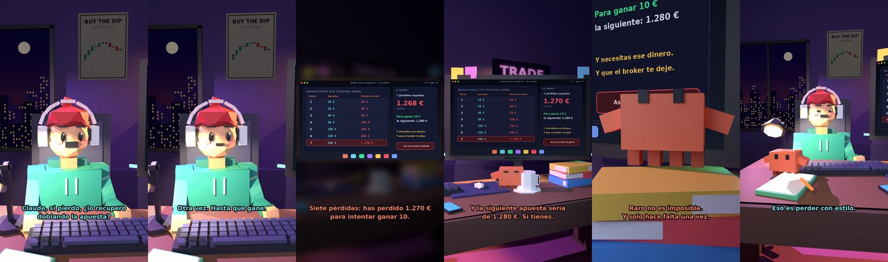

# Claude, si pierdo, ¿lo recupero doblando la apuesta?



**Archivo de guion:** `guiones/trading_13_doblar_para_recuperar.json` · **Ambiente:** `noche_trading` · **Duración:** 42 s (252 frames de animación a 6 fps)

La «martingala»: doblar la apuesta tras cada pérdida para recuperar. Claude hace la cuenta exacta: 7 pérdidas seguidas con 10 € iniciales suponen 1.270 € perdidos para ganar 10 €.

**Gancho (primera frase):** «Claude, si pierdo, ¿lo recupero doblando la apuesta?»

## Cómo se genera el vídeo
```bash
python3 -I motor/montar_video.py guiones/trading_13_doblar_para_recuperar.json salidas/trading_13_doblar_para_recuperar.mp4
```
El guion se creó con `motor/generar_guiones.py` (tiempos automáticos según la longitud de cada frase y pantallas sincronizadas con el diálogo). Biblioteca usada: `biblioteca/noche_trading/`.

## Guion plano a plano

| # | Tiempo | Quién | Texto | Plano | Emoción / pose / estado | Pantalla del monitor |
|---|---|---|---|---|---|---|
| 1 | 0.0–3.8 | Humano | Claude, si pierdo, ¿lo recupero / doblando la apuesta? | `humano` | ilusionado | martingala (22.38 s) |
| 2 | 3.8–6.1 | Claude | Hmm. ¿Y si pierdes otra vez? | `monitor` | mira_izq |  |
| 3 | 6.1–7.7 | Humano | La doblo otra vez. | `dos` | bobo |  |
| 4 | 7.7–9.2 | Claude | ¿Y otra? | `claude_ojos` | feliz |  |
| 5 | 9.2–11.3 | Humano | Otra vez. Hasta que gane. | `humano` | ilusionado |  |
| 6 | 11.3–14.3 | Claude | Haz la cuenta conmigo. / 10, 20, 40, 80... | `cenital` | mira_der |  |
| 7 | 14.3–15.9 | Humano | ...160, 320, 640. | `dos` | confundido |  |
| 8 | 15.9–20.1 | Claude | Siete pérdidas: has perdido 1.270 € / para intentar ganar 10. | `pantalla_completa` | idle |  |
| 9 | 20.1–22.2 | Humano | ¿¡1.270 € para ganar 10!? | `humano` | preocupado |  |
| 10 | 22.2–25.9 | Claude | Y la siguiente apuesta sería / de 1.280 €. Si tienes. | `monitor` | feliz |  |
| 11 | 25.9–28.2 | Humano | Pero siete seguidas es raro. | `dos` | bobo |  |
| 12 | 28.2–31.8 | Claude | Raro no es imposible. / Y solo hace falta una vez. | `claude_ojos` | idle, empuje de cámara |  |
| 13 | 31.8–33.8 | Humano | ¿Entonces cómo recupero? | `humano` | confundido |  |
| 14 | 33.8–37.1 | Claude | Pierdes poco, con stop, / y aceptas la pérdida. | `monitor` | mira_arriba |  |
| 15 | 37.1–39.2 | Humano | Eso es perder con estilo. | `dos` | feliz |  |
| 16 | 39.2–42.0 | Claude | Es sobrevivir. / En fin... eres humano. | `general` | feliz |  |

## Datos reales que aparecen o se mencionan

- Cuenta exacta: apuestas 10 €, 20 €, 40 €, 80 €, 160 €, 320 €, 640 €; tras 7 pérdidas seguidas has perdido 10 × (2^7 − 1) = 1.270 € y la siguiente apuesta sería de 1.280 € para ganar 10 €. Ejemplo matemático ilustrativo: las rachas existen, los brokers tienen límites y tu capital es finito.

## Notas de producción

- **Humor:** Claude es sarcástico y pícaro («como el que le salva el culo»); el humano es ingenuo y algo tonto (expresiones `bobo`, `ilusionado`, `confundido`).
- **Voces:** son «blips» sintéticos (no hay voz real). Para voz real: ElevenLabs o grabarla y sustituir el audio.
- **Cifras y leyes:** los datos reales están citados arriba; las cuentas de ejemplo (márgenes, 214 tiendas, etc.) son ilustrativas. No es asesoramiento financiero ni legal.
