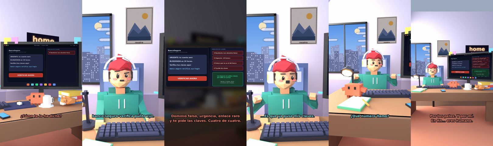

# «Tu banco te va a bloquear la cuenta»



**Archivo de guion:** `guiones/util_02_estafa_banco.json` · **Ambiente:** `dia_casa` · **Duración:** 42 s (252 frames de animación a 6 fps)

Un SMS «URGENTE» de un falso banco. Claude enseña a reconocer el phishing (remitente, urgencia, enlace, petición de claves) y qué hacer si ya has picado.

**Gancho (primera frase):** «¡Claude! Mi banco me va a bloquear la cuenta.»

## Cómo se genera el vídeo
```bash
python3 -I motor/montar_video.py guiones/util_02_estafa_banco.json salidas/util_02_estafa_banco.mp4
```
El guion se creó con `motor/generar_guiones.py` (tiempos automáticos según la longitud de cada frase y pantallas sincronizadas con el diálogo). Biblioteca usada: `biblioteca/dia_casa/`.

## Guion plano a plano

| # | Tiempo | Quién | Texto | Plano | Emoción / pose / estado | Pantalla del monitor |
|---|---|---|---|---|---|---|
| 1 | 0.0–3.4 | Humano | ¡Claude! Mi banco me / va a bloquear la cuenta. | `humano` | preocupado | phishing (19.74 s) |
| 2 | 3.4–5.3 | Claude | ¿Cómo te lo ha dicho? | `monitor` | mira_izq |  |
| 3 | 5.3–7.3 | Humano | Por SMS. Pone «URGENTE». | `dos` | preocupado |  |
| 4 | 7.3–9.6 | Claude | Por eso. / Léeme el remitente. | `claude_ojos` | idle |  |
| 5 | 9.6–12.2 | Humano | banco-seguro-verifica punto xyz. | `humano` | bobo |  |
| 6 | 12.2–17.8 | Claude | Dominio falso, urgencia, enlace raro / y te pide las claves. Cuatro de cuatro. | `pantalla_completa` | idle |  |
| 7 | 17.8–20.0 | Humano | Pero me da miedo no pulsar. | `dos` | confundido |  |
| 8 | 20.0–24.4 | Claude | Los bancos no piden claves / por SMS ni por correo (INCIBE). | `cenital` | mira_der |  |
| 9 | 24.4–26.8 | Humano | ...Es que ya puse mis claves. | `humano` | preocupado, pose hombros |  |
| 10 | 26.8–30.7 | Claude | Llama a tu banco YA. / Bloquea tarjeta y cambia claves. | `claude_ojos` | idle, empuje de cámara |  |
| 11 | 30.7–32.4 | Humano | ¿Qué número llamo? | `dos` | bobo |  |
| 12 | 32.4–36.9 | Claude | El de tu tarjeta. No el del SMS. / Obvio, pero merece decirse. | `monitor` | feliz |  |
| 13 | 36.9–38.4 | Humano | ¡Salvado! | `humano` | feliz |  |
| 14 | 38.4–42.0 | Claude | Por los pelos. Y por mí. / En fin... eres humano. | `general` | feliz |  |

## Datos reales que aparecen o se mencionan

- Señales de phishing/smishing bancario según INCIBE: remitente o dominio que no es el oficial, urgencia para que pulses sin pensar, enlaces a webs falsas y petición de usuario, claves o códigos. Las entidades no piden contraseñas, números de tarjeta ni códigos por correo/SMS. Si ya introdujiste datos, contacta cuanto antes con tu entidad (teléfono oficial, por ejemplo el de tu tarjeta).
  - Fuente: [INCIBE — infografía «No te fíes» (qué no te pedirá nunca una entidad)](https://www.incibe.es/sites/default/files/Cuidadan%C3%ADa/Infograf%C3%ADas/infografia_nofiarnos_psv.pdf)
  - Fuente: [INCIBE — «No tienes que activar ningún nuevo sistema de seguridad de tu entidad bancaria»](https://www.incibe.es/ciudadania/avisos/no-tienes-que-activar-ningun-nuevo-sistema-de-seguridad-de-tu-entidad-bancaria)

## Notas de producción

- **Humor:** Claude es sarcástico y pícaro («como el que le salva el culo»); el humano es ingenuo y algo tonto (expresiones `bobo`, `ilusionado`, `confundido`).
- **Voces:** son «blips» sintéticos (no hay voz real). Para voz real: ElevenLabs o grabarla y sustituir el audio.
- **Cifras y leyes:** los datos reales están citados arriba; las cuentas de ejemplo (márgenes, 214 tiendas, etc.) son ilustrativas. No es asesoramiento financiero ni legal.
