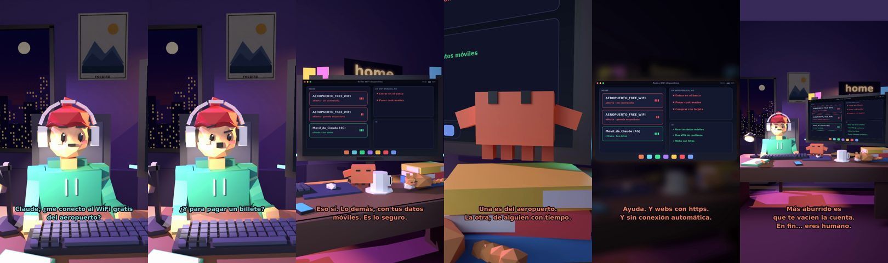

# Claude, ¿me conecto al WiFi gratis del aeropuerto?



**Archivo de guion:** `guiones/util_03_wifi_publica.json` · **Ambiente:** `noche_casa` · **Duración:** 40 s (240 frames de animación a 6 fps)

El humano quiere conectarse al WiFi gratis del aeropuerto para mirar el banco. Claude le enseña el riesgo de las redes abiertas, la red «gemela» falsa y qué hacer en su lugar.

**Gancho (primera frase):** «Claude, ¿me conecto al WiFi gratis del aeropuerto?»

## Cómo se genera el vídeo
```bash
python3 -I motor/montar_video.py guiones/util_03_wifi_publica.json salidas/util_03_wifi_publica.mp4
```
El guion se creó con `motor/generar_guiones.py` (tiempos automáticos según la longitud de cada frase y pantallas sincronizadas con el diálogo). Biblioteca usada: `biblioteca/noche_casa/`.

## Guion plano a plano

| # | Tiempo | Quién | Texto | Plano | Emoción / pose / estado | Pantalla del monitor |
|---|---|---|---|---|---|---|
| 1 | 0.0–4.0 | Humano | Claude, ¿me conecto al WiFi gratis / del aeropuerto? | `humano` | ilusionado | wifi (36.39 s) |
| 2 | 4.0–5.8 | Claude | Depende. ¿Para qué? | `monitor` | mira_izq |  |
| 3 | 5.8–7.7 | Humano | Para mirar el banco. | `dos` | bobo |  |
| 4 | 7.7–9.4 | Claude | No. | `claude_ojos` | idle |  |
| 5 | 9.4–11.6 | Humano | ¿Y para pagar un billete? | `humano` | confundido |  |
| 6 | 11.6–13.3 | Claude | Tampoco. | `cenital` | mira_der |  |
| 7 | 13.3–15.2 | Humano | ¿Y para mirar memes? | `dos` | ilusionado |  |
| 8 | 15.2–19.5 | Claude | Eso sí. Lo demás, con tus datos / móviles. Es lo seguro. | `monitor` | feliz |  |
| 9 | 19.5–22.7 | Humano | Hay dos redes que se llaman casi igual. | `humano` | confundido |  |
| 10 | 22.7–27.0 | Claude | Una es del aeropuerto. / La otra, de alguien con tiempo. | `claude_ojos` | mira_izq, empuje de cámara |  |
| 11 | 27.0–28.7 | Humano | ¿Y una VPN? | `dos` | bobo |  |
| 12 | 28.7–32.8 | Claude | Ayuda. Y webs con https. / Y sin conexión automática. | `pantalla_completa` | idle |  |
| 13 | 32.8–35.1 | Humano | Qué aburrido el aeropuerto. | `humano` | preocupado |  |
| 14 | 35.1–40.0 | Claude | Más aburrido es / que te vacíen la cuenta. / En fin... eres humano. | `general` | feliz |  |

## Datos reales que aparecen o se mencionan

- INCIBE advierte de que las redes WiFi abiertas suelen carecer de seguridad adecuada y los datos pueden ser interceptados; recomienda evitar operar con información sensible (contraseñas, banca) y desactivar la conexión automática a redes públicas. Otras fuentes recomiendan datos móviles, VPN de confianza y webs https.
  - Fuente: [INCIBE — Conexiones inalámbricas seguras](https://www.incibe.es/ciudadania/blog/conexiones-inalambricas-seguras-sabes-como-conseguirlo)
  - Fuente: [Comunidad de Madrid — Acceder a redes WiFi públicas: riesgos y consejos](https://www.comunidad.madrid/node/76023)
  - Fuente: [Consumo Responde — Por qué no operar con el banco en WiFi públicas](https://www.consumoresponde.es/node/256529)
- La «red gemela» (nombre casi idéntico a la oficial) es un truco conocido; el ejemplo de la pantalla es ilustrativo.

## Notas de producción

- **Humor:** Claude es sarcástico y pícaro («como el que le salva el culo»); el humano es ingenuo y algo tonto (expresiones `bobo`, `ilusionado`, `confundido`).
- **Voces:** son «blips» sintéticos (no hay voz real). Para voz real: ElevenLabs o grabarla y sustituir el audio.
- **Cifras y leyes:** los datos reales están citados arriba; las cuentas de ejemplo (márgenes, 214 tiendas, etc.) son ilustrativas. No es asesoramiento financiero ni legal.
