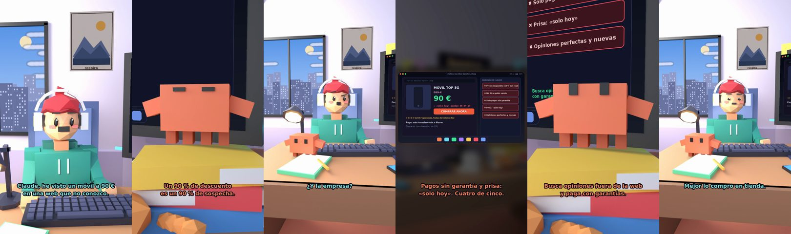

# Claude, he visto un móvil a 90 € en una web que no conozco



**Archivo de guion:** `guiones/util_05_chollo_falso.json` · **Ambiente:** `dia_casa` · **Duración:** 42 s (252 frames de animación a 6 fps)

Un chollo demasiado bueno en una web desconocida. Claude revisa las señales de una tienda online fraudulenta (precio, datos de la empresa, formas de pago, prisa y opiniones) y qué hacer.

**Gancho (primera frase):** «Claude, he visto un móvil a 90 € en una web que no conozco.»

## Cómo se genera el vídeo
```bash
python3 -I motor/montar_video.py guiones/util_05_chollo_falso.json salidas/util_05_chollo_falso.mp4
```
El guion se creó con `motor/generar_guiones.py` (tiempos automáticos según la longitud de cada frase y pantallas sincronizadas con el diálogo). Biblioteca usada: `biblioteca/dia_casa/`.

## Guion plano a plano

| # | Tiempo | Quién | Texto | Plano | Emoción / pose / estado | Pantalla del monitor |
|---|---|---|---|---|---|---|
| 1 | 0.0–3.9 | Humano | Claude, he visto un móvil a 90 € / en una web que no conozco. | `humano` | ilusionado | tienda_falsa (35.91 s) |
| 2 | 3.9–6.1 | Claude | ¿Y cuánto cuesta normalmente? | `monitor` | mira_izq |  |
| 3 | 6.1–8.3 | Humano | 899. ¡Es un 90 % de descuento! | `dos` | bobo |  |
| 4 | 8.3–11.3 | Claude | Un 90 % de descuento / es un 90 % de sospecha. | `claude_ojos` | feliz |  |
| 5 | 11.3–13.2 | Humano | Pero tiene mil estrellas. | `humano` | confundido |  |
| 6 | 13.2–16.4 | Claude | Cuarenta y siete opiniones. / Todas del mismo día. | `cenital` | mira_der |  |
| 7 | 16.4–17.8 | Humano | ¿Y la empresa? | `dos` | confundido |  |
| 8 | 17.8–21.5 | Claude | No dice quién vende. Ni / dirección ni CIF. Qué misterio. | `monitor` | feliz |  |
| 9 | 21.5–23.6 | Humano | Solo me deja pagar por Bizum. | `humano` | preocupado |  |
| 10 | 23.6–27.4 | Claude | Pagos sin garantía y prisa: / «solo hoy». Cuatro de cinco. | `pantalla_completa` | idle |  |
| 11 | 27.4–28.8 | Humano | ¿Y qué hago? | `dos` | preocupado |  |
| 12 | 28.8–32.3 | Claude | Busca opiniones fuera de la web / y paga con garantías. | `claude_ojos` | idle, empuje de cámara |  |
| 13 | 32.3–34.2 | Humano | ¿Y el candado de la web? | `humano` | bobo |  |
| 14 | 34.2–37.2 | Claude | Solo dice que va cifrada, / no que sea honesta. | `monitor` | mira_arriba |  |
| 15 | 37.2–39.2 | Humano | Mejor lo compro en tienda. | `dos` | feliz |  |
| 16 | 39.2–42.0 | Claude | Aburrido y seguro. / En fin... eres humano. | `general` | feliz |  |

## Datos reales que aparecen o se mencionan

- Señales según INCIBE: un solo indicio no basta, pero conviene revisar quién es la empresa (aviso legal, política de privacidad), buscar opiniones fuera de la propia web, desconfiar de ofertas excesivamente baratas y de la prisa, usar formas de pago con garantías y recordar que el candado/HTTPS solo indica conexión cifrada, no que la web sea fiable.
  - Fuente: [INCIBE — Compras seguras online](https://www.incibe.es/ciudadania/tematicas/compras-seguras-online)
  - Fuente: [INCIBE — Claves para detectar una compra fraudulenta](https://www.incibe.es/empresas/blog/tienes-una-tienda-online-conoce-las-claves-para-detectar-una-compra-fraudulenta)

## Notas de producción

- **Humor:** Claude es sarcástico y pícaro («como el que le salva el culo»); el humano es ingenuo y algo tonto (expresiones `bobo`, `ilusionado`, `confundido`).
- **Voces:** son «blips» sintéticos (no hay voz real). Para voz real: ElevenLabs o grabarla y sustituir el audio.
- **Cifras y leyes:** los datos reales están citados arriba; las cuentas de ejemplo (márgenes, 214 tiendas, etc.) son ilustrativas. No es asesoramiento financiero ni legal.
