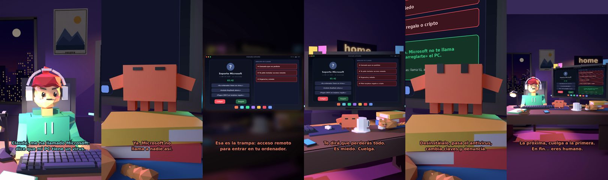

# Claude, me ha llamado Microsoft: dice que mi PC tiene un virus



**Archivo de guion:** `guiones/util_06_falso_tecnico.json` · **Ambiente:** `noche_casa` · **Duración:** 42 s (252 frames de animación a 6 fps)

La clásica llamada del «soporte técnico de Microsoft»: virus inventado, acceso remoto y pago en tarjetas regalo. Claude le dice por qué colgar y qué hacer si ya has instalado algo.

**Gancho (primera frase):** «Claude, me ha llamado Microsoft: dice que mi PC tiene un virus.»

## Cómo se genera el vídeo
```bash
python3 -I motor/montar_video.py guiones/util_06_falso_tecnico.json salidas/util_06_falso_tecnico.mp4
```
El guion se creó con `motor/generar_guiones.py` (tiempos automáticos según la longitud de cada frase y pantallas sincronizadas con el diálogo). Biblioteca usada: `biblioteca/noche_casa/`.

## Guion plano a plano

| # | Tiempo | Quién | Texto | Plano | Emoción / pose / estado | Pantalla del monitor |
|---|---|---|---|---|---|---|
| 1 | 0.0–4.3 | Humano | Claude, me ha llamado Microsoft: / dice que mi PC tiene un virus. | `humano` | preocupado | llamada (33.62 s) |
| 2 | 4.3–6.5 | Claude | ¿Tú has llamado a Microsoft? | `monitor` | mira_izq |  |
| 3 | 6.5–8.2 | Humano | No. Me ha llamado él. | `dos` | bobo |  |
| 4 | 8.2–10.8 | Claude | Ya. Microsoft no / llama a nadie así. | `claude_ojos` | feliz |  |
| 5 | 10.8–12.4 | Humano | Pero sabe mi nombre. | `humano` | confundido |  |
| 6 | 12.4–15.3 | Claude | Y el de media ciudad. / Lo sacan de listas. | `cenital` | mira_der |  |
| 7 | 15.3–17.3 | Humano | Me pide instalar AnyDesk. | `dos` | preocupado |  |
| 8 | 17.3–21.4 | Claude | Esa es la trampa: acceso remoto / para entrar en tu ordenador. | `pantalla_completa` | idle |  |
| 9 | 21.4–22.9 | Humano | ¿Y si no lo hago? | `humano` | preocupado |  |
| 10 | 22.9–26.0 | Claude | Te dirá que perderás todo. / Es miedo. Cuelga. | `monitor` | feliz |  |
| 11 | 26.0–27.9 | Humano | ...Es que ya lo instalé. | `dos` | preocupado, pose hombros |  |
| 12 | 27.9–31.9 | Claude | Desinstálalo, pasa el antivirus, / cambia claves y denuncia. | `claude_ojos` | idle, empuje de cámara |  |
| 13 | 31.9–33.4 | Humano | ¿Y mi dinero? | `humano` | confundido |  |
| 14 | 33.4–36.7 | Claude | Llama al banco ya. Y / al 017 si necesitas ayuda. | `monitor` | mira_arriba |  |
| 15 | 36.7–38.2 | Humano | Gracias, Claude. | `dos` | feliz |  |
| 16 | 38.2–42.0 | Claude | La próxima, cuelga a la primera. / En fin... eres humano. | `general` | feliz |  |

## Datos reales que aparecen o se mencionan

- Según INCIBE y Microsoft: Microsoft no hace llamadas no solicitadas para ofrecer soporte ni pedir datos; los estafadores piden instalar herramientas de acceso remoto legítimas (AnyDesk, TeamViewer, Asistencia rápida) y a veces cobran por «desbloquear» el equipo; nunca se paga soporte con criptomonedas o tarjetas regalo. Si ya diste acceso: analiza con antivirus, desinstala lo que te pidieron instalar, cambia tus claves y denuncia a Policía Nacional o Guardia Civil; línea de ayuda de INCIBE 017.
  - Fuente: [INCIBE — ¿Microsoft te ha llamado sin haberlo solicitado?](https://www.incibe.es/ciudadania/blog/microsoft-te-ha-llamado-sin-haberlo-solicitado)
  - Fuente: [INCIBE — Historias reales: el timo del falso soporte técnico](https://www.incibe.es/empresas/blog/historias-reales-el-timo-del-falso-soporte-tecnico)
  - Fuente: [INCIBE — nueva estrategia de estafa por Bizum solicitando dinero](https://www.incibe.es/ciudadania/avisos/detectada-nueva-estrategia-de-estafa-traves-de-bizum-solicitando-dinero-en)

## Notas de producción

- **Humor:** Claude es sarcástico y pícaro («como el que le salva el culo»); el humano es ingenuo y algo tonto (expresiones `bobo`, `ilusionado`, `confundido`).
- **Voces:** son «blips» sintéticos (no hay voz real). Para voz real: ElevenLabs o grabarla y sustituir el audio.
- **Cifras y leyes:** los datos reales están citados arriba; las cuentas de ejemplo (márgenes, 214 tiendas, etc.) son ilustrativas. No es asesoramiento financiero ni legal.
