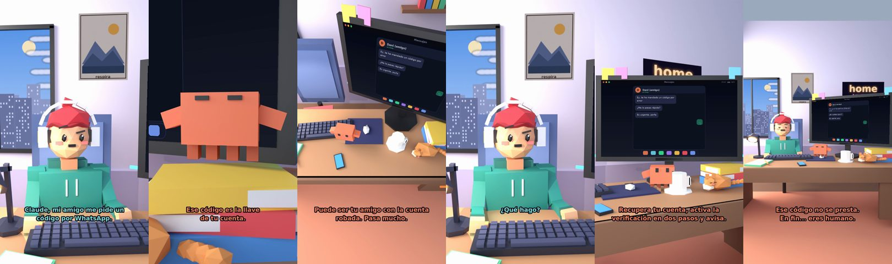

# Claude, mi amigo me pide un código por WhatsApp



**Archivo de guion:** `guiones/util_07_codigo_whatsapp.json` · **Ambiente:** `dia_casa` · **Duración:** 40 s (240 frames de animación a 6 fps)

«Te envié un código por error, ¿me lo pasas?» Claude explica la estafa del código de 6 dígitos de WhatsApp: no se comparte nunca, aunque lo pida un conocido.

**Gancho (primera frase):** «Claude, mi amigo me pide un código por WhatsApp.»

## Cómo se genera el vídeo
```bash
python3 -I motor/montar_video.py guiones/util_07_codigo_whatsapp.json salidas/util_07_codigo_whatsapp.mp4
```
El guion se creó con `motor/generar_guiones.py` (tiempos automáticos según la longitud de cada frase y pantallas sincronizadas con el diálogo). Biblioteca usada: `biblioteca/dia_casa/`.

## Guion plano a plano

| # | Tiempo | Quién | Texto | Plano | Emoción / pose / estado | Pantalla del monitor |
|---|---|---|---|---|---|---|
| 1 | 0.0–3.7 | Humano | Claude, mi amigo me pide un / código por WhatsApp. | `humano` | confundido | mensajes (28.16 s) |
| 2 | 3.7–5.3 | Claude | ¿Qué código? | `monitor` | mira_izq |  |
| 3 | 5.3–8.3 | Humano | Uno de seis números. / Me llegó por SMS. | `dos` | bobo |  |
| 4 | 8.3–11.2 | Claude | Ese código es la llave / de tu cuenta. | `claude_ojos` | feliz |  |
| 5 | 11.2–12.8 | Humano | Pero es mi amigo. | `humano` | preocupado |  |
| 6 | 12.8–16.7 | Claude | Puede ser tu amigo con la cuenta / robada. Pasa mucho. | `cenital` | mira_der |  |
| 7 | 16.7–19.1 | Humano | ¿Y si de verdad lo necesita? | `dos` | confundido |  |
| 8 | 19.1–22.6 | Claude | Nadie necesita que le / reenvíes un código tuyo. | `monitor` | feliz |  |
| 9 | 22.6–24.3 | Humano | ¿Qué hago? | `humano` | confundido |  |
| 10 | 24.3–28.2 | Claude | No lo compartas. Llámale / por teléfono y pregúntale. | `claude_ojos` | idle, empuje de cámara |  |
| 11 | 28.2–30.0 | Humano | ¿Y si ya se lo pasé? | `dos` | preocupado, pose hombros |  |
| 12 | 30.0–34.8 | Claude | Recupera tu cuenta, activa la / verificación en dos pasos y avisa. | `monitor` | mira_arriba |  |
| 13 | 34.8–36.4 | Humano | Gracias, Claude. | `humano` | feliz |  |
| 14 | 36.4–40.0 | Claude | Ese código no se presta. / En fin... eres humano. | `general` | feliz |  |

## Datos reales que aparecen o se mencionan

- Estafa del código de 6 dígitos: alguien (a veces un contacto con la cuenta ya robada) dice haberte enviado un código por error y te pide que se lo reenvíes; ese código sirve para tomar el control de tu cuenta. La Policía Nacional aconseja no compartir ningún código de WhatsApp, ni con conocidos; avisa al contacto por otro canal (llamada). Si ya lo diste, recupera la cuenta y activa la verificación en dos pasos.
  - Fuente: [Maldita.es — El código de 6 dígitos de WhatsApp: cómo funciona el robo de cuentas](https://maldita.es/malditobulo/20260116/codigo-whatsapp-digitos-sms-robo-cuenta/)
  - Fuente: [Genbeta — La Guardia Civil avisa de la estafa que te puede robar la cuenta de WhatsApp](https://www.genbeta.com/seguridad/guardia-civil-avisa-peligro-que-corre-tu-cuenta-whatsapp-esta-sencilla-estafa-te-puede-robar)

## Notas de producción

- **Humor:** Claude es sarcástico y pícaro («como el que le salva el culo»); el humano es ingenuo y algo tonto (expresiones `bobo`, `ilusionado`, `confundido`).
- **Voces:** son «blips» sintéticos (no hay voz real). Para voz real: ElevenLabs o grabarla y sustituir el audio.
- **Cifras y leyes:** los datos reales están citados arriba; las cuentas de ejemplo (márgenes, 214 tiendas, etc.) son ilustrativas. No es asesoramiento financiero ni legal.
