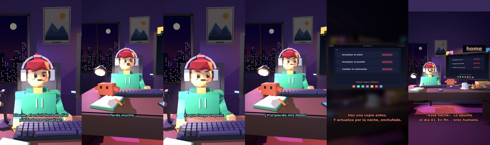

# Claude, el móvil lleva 40 días pidiéndome actualizar



**Archivo de guion:** `guiones/util_08_actualizaciones.json` · **Ambiente:** `noche_casa` · **Duración:** 36 s (216 frames de animación a 6 fps)

La actualización pospuesta durante semanas. Claude explica por qué conviene instalarla y el truco de hacerlo por la noche enchufado.

**Gancho (primera frase):** «Claude, el móvil lleva 40 días pidiéndome actualizar.»

## Cómo se genera el vídeo
```bash
python3 -I motor/montar_video.py guiones/util_08_actualizaciones.json salidas/util_08_actualizaciones.mp4
```
El guion se creó con `motor/generar_guiones.py` (tiempos automáticos según la longitud de cada frase y pantallas sincronizadas con el diálogo). Biblioteca usada: `biblioteca/noche_casa/`.

## Guion plano a plano

| # | Tiempo | Quién | Texto | Plano | Emoción / pose / estado | Pantalla del monitor |
|---|---|---|---|---|---|---|
| 1 | 0.0–5.1 | Humano | Claude, el móvil lleva 40 días / pidiéndome actualizar. | `humano` | bobo | recordatorios (30.07 s) |
| 2 | 5.1–7.6 | Claude | ¿Y por qué no lo haces? | `monitor` | mira_izq |  |
| 3 | 7.6–9.6 | Humano | Tarda mucho. | `dos` | bobo |  |
| 4 | 9.6–12.8 | Claude | Veinte minutos. Llevas / 40 días. | `claude_ojos` | feliz |  |
| 5 | 12.8–15.1 | Humano | Es que luego va peor. | `humano` | preocupado |  |
| 6 | 15.1–20.6 | Claude | Las actualizaciones corrigen / fallos de seguridad. Importa. | `cenital` | mira_der |  |
| 7 | 20.6–23.2 | Humano | ¿Y si pierdo mis fotos? | `dos` | preocupado |  |
| 8 | 23.2–28.6 | Claude | Haz una copia antes. / Y actualiza por la noche, enchufado. | `pantalla_completa` | idle |  |
| 9 | 28.6–30.6 | Humano | Vale. Esta noche. | `humano` | ilusionado |  |
| 10 | 30.6–36.0 | Claude | «Esta noche». Lo apunto / el día 41. En fin... eres humano. | `general` | feliz |  |

## Datos reales que aparecen o se mencionan

- Consejo general de seguridad: las actualizaciones suelen corregir vulnerabilidades; instálalas desde los canales oficiales del fabricante.

## Notas de producción

- **Humor:** Claude es sarcástico y pícaro («como el que le salva el culo»); el humano es ingenuo y algo tonto (expresiones `bobo`, `ilusionado`, `confundido`).
- **Voces:** son «blips» sintéticos (no hay voz real). Para voz real: ElevenLabs o grabarla y sustituir el audio.
- **Cifras y leyes:** los datos reales están citados arriba; las cuentas de ejemplo (márgenes, 214 tiendas, etc.) son ilustrativas. No es asesoramiento financiero ni legal.
