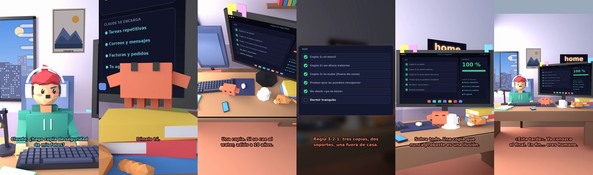

# Claude, ¿hago copia de seguridad de mis fotos?



**Archivo de guion:** `guiones/util_09_copia_de_seguridad.json` · **Ambiente:** `dia_casa` · **Duración:** 38 s (228 frames de animación a 6 fps)

La regla 3-2-1 explicada con humor: tres copias, en dos soportes distintos y una fuera de casa. Aviso: el disco duro se rompe justo el día que no hay copia.

**Gancho (primera frase):** «Claude, ¿hago copia de seguridad de mis fotos?»

## Cómo se genera el vídeo
```bash
python3 -I motor/montar_video.py guiones/util_09_copia_de_seguridad.json salidas/util_09_copia_de_seguridad.mp4
```
El guion se creó con `motor/generar_guiones.py` (tiempos automáticos según la longitud de cada frase y pantallas sincronizadas con el diálogo). Biblioteca usada: `biblioteca/dia_casa/`.

## Guion plano a plano

| # | Tiempo | Quién | Texto | Plano | Emoción / pose / estado | Pantalla del monitor |
|---|---|---|---|---|---|---|
| 1 | 0.0–4.0 | Humano | Claude, ¿hago copia de seguridad / de mis fotos? | `humano` | confundido | tareas (32.73 s) |
| 2 | 4.0–5.9 | Claude | Sí. Ya. | `monitor` | mira_izq |  |
| 3 | 5.9–8.6 | Humano | ¿Dónde están ahora / mis fotos? | `dos` | bobo |  |
| 4 | 8.6–10.4 | Claude | Dímelo tú. | `claude_ojos` | idle |  |
| 5 | 10.4–12.7 | Humano | En el móvil. Solo ahí. | `humano` | preocupado |  |
| 6 | 12.7–16.8 | Claude | Una copia. Si se cae al / water, adiós a 10 años. | `cenital` | mira_der |  |
| 7 | 16.8–18.6 | Humano | ¿Qué hago? | `dos` | preocupado |  |
| 8 | 18.6–23.6 | Claude | Regla 3-2-1: tres copias, dos / soportes, una fuera de casa. | `pantalla_completa` | idle |  |
| 9 | 23.6–26.2 | Humano | ¿Y comprobar que funcionan? | `humano` | confundido |  |
| 10 | 26.2–31.1 | Claude | Sobre todo. Una copia que / nunca probaste es una ilusión. | `monitor` | feliz |  |
| 11 | 31.1–33.1 | Humano | Esta tarde lo hago. | `dos` | feliz |  |
| 12 | 33.1–38.0 | Claude | «Esta tarde». Ya conozco / el final. En fin... eres humano. | `general` | feliz |  |

## Datos reales que aparecen o se mencionan

- Pauta conocida de copias de seguridad «3-2-1»: tres copias de tus datos, en dos tipos de soporte distintos, con una copia fuera de casa. Pauta orientativa.

## Notas de producción

- **Humor:** Claude es sarcástico y pícaro («como el que le salva el culo»); el humano es ingenuo y algo tonto (expresiones `bobo`, `ilusionado`, `confundido`).
- **Voces:** son «blips» sintéticos (no hay voz real). Para voz real: ElevenLabs o grabarla y sustituir el audio.
- **Cifras y leyes:** los datos reales están citados arriba; las cuentas de ejemplo (márgenes, 214 tiendas, etc.) son ilustrativas. No es asesoramiento financiero ni legal.
